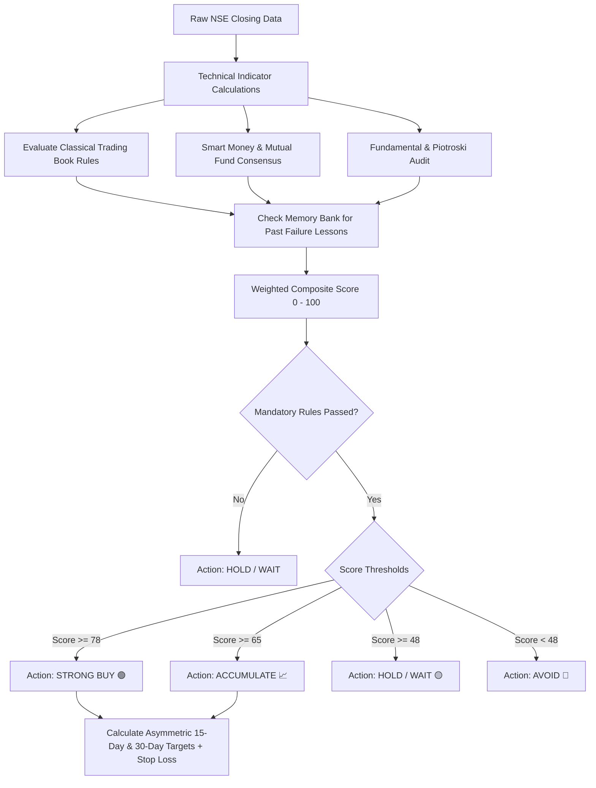

# 🏛️ BullGuard AI — Indian Stock Market Intelligence & Automated EOD Audit System

**BullGuard AI** is an automated algorithmic stock analysis, prediction, and verification platform designed specifically for the **Indian Equities Market (NSE / BSE)**.

It combines **classical trading master frameworks** (Mark Minervini, William O'Neil, Stan Weinstein), **institutional Smart Money / Mutual Fund tracking**, **fundamental health scores**, and an **automated self-learning audit loop** that runs daily in the cloud via GitHub Actions and dispatches verified signals to Telegram.

---

## 📑 Table of Contents
1. [Core Philosophy](#-core-philosophy)
2. [How Predictions Are Calculated (The 7-Step Pipeline)](#-how-predictions-are-calculated-the-7-step-pipeline)
3. [What Factors & Indicators Are Considered](#-what-factors--indicators-are-considered)
   - [A. Technical Structure & Moving Averages](#a-technical-structure--moving-averages)
   - [B. Classical Trading Book Rules & Patterns](#b-classical-trading-book-rules--patterns)
   - [C. Smart Money & Mutual Fund Tracking](#c-smart-money--mutual-fund-tracking)
   - [D. Fundamental Health & Piotroski F-Score](#d-fundamental-health--piotroski-f-score)
   - [E. Upcoming Earnings Catalyst Buffer](#e-upcoming-earnings-catalyst-buffer)
   - [F. Database Lesson Memory (Self-Learning Loop)](#f-database-lesson-memory-self-learning-loop)
4. [Final Decision Matrix & Composite Formula](#-final-decision-matrix--composite-formula)
5. [Target Horizons: Swing (15-Day) vs. Monthly (30-Day)](#-target-horizons-swing-15-day-vs-monthly-30-day)
6. [Daily Verification Audit & Post-Mortem Engine](#-daily-verification-audit--post-mortem-engine)
7. [Cloud Automation & Telegram Alerts](#-cloud-automation--telegram-alerts)
8. [Local Development & CLI Tools](#-local-development--cli-tools)

---

## 🎯 Core Philosophy

Most retail trading models rely purely on single lagging indicators (like RSI or simple MACD crossovers), resulting in high whipsaw rates. 

BullGuard AI operates on **multi-factor confluence**:
> **A trade signal is ONLY valid when Institutional Inflows, Technical Stage 2 Structure, Fundamental Health, and Volatility Contraction align simultaneously.**

Every prediction is continuously audited end-of-day against real market high/low price action. If a trade fails, an automated **Post-Mortem diagnostic** records the root cause into a memory bank to protect future decisions.

---

## 🧠 How Predictions Are Calculated (The 7-Step Pipeline)



---

## 🔍 What Factors & Indicators Are Considered

### A. Technical Structure & Moving Averages
We compute technical indicators over 2 years of daily candlestick data:
* **Exponential Moving Averages (EMA 20, 50, 150, 200)**: Evaluates trend direction and hierarchy. Bullish trend confirmed when:
  $$\text{Price} > \text{EMA}_{50} > \text{EMA}_{150} > \text{EMA}_{200}$$
* **Relative Strength Index (RSI-14)**: Measures momentum. Bullish accumulation zone is $45 \le \text{RSI} \le 68$. RSI above 75 triggers an overbought warning.
* **MACD (12, 26, 9)**: Gauges accelerating momentum via the MACD Line, Signal Line, and Histogram.
* **Average True Range (ATR-14)**: Measures daily volatility expansion to set dynamic, volatility-adjusted stop-loss and profit target distances.
* **52-Week High/Low Proximity**: Validates that the stock is within 25% of its 52-week high (Minervini rule).

---

### B. Classical Trading Book Rules & Patterns
BullGuard AI hard-codes rules from renowned market wizards:

1. **Mark Minervini — Specific Entry Point Analysis (SEPA) & VCP**:
   * **Stage 2 Uptrend Criteria**: 200 EMA must be trending up for at least 1 month.
   * **Volatility Contraction Pattern (VCP)**: Decreasing volume during base contractions indicates supply dry-up before breakout.
2. **Stan Weinstein — Stage Analysis**:
   * Identifies transitions from Stage 1 (Accumulation Base) into **Stage 2 (Advancing Phase)**.
3. **William O'Neil — CAN SLIM**:
   * Focuses on institutional sponsorship (the "I" in CAN SLIM) and strong quarterly EPS expansion.
4. **Nicolas Darvas — Box Theory**:
   * Validates upper consolidation boundary breakouts.

> **Mandatory Filters**: If a stock fails fundamental Stage 2 criteria (e.g. trading below its 200-day moving average), the system **strictly overrides the signal to HOLD/AVOID**, regardless of other indicators.

---

### C. Smart Money & Mutual Fund Tracking
Retail investors react to news; institutions drive price trends. We track institutional footprint across top Indian Asset Management Companies (AMCs) like HDFC, SBI, ICICI Prudential, Nippon India, and Parag Parikh Flexi Cap:
* **Total Institutional Capital**: Quantified in ₹ Crores invested across tracked funds.
* **Month-over-Month (MoM) Actions**:
  * 🚀 **Heavy Accumulation**: Multiple funds scaling position sizes.
  * 📈 **Accumulating**: Consistent net positive inflows.
  * ⚖️ **Stable Hold**: Institutional lock-in.
  * 📉 **Trimming**: Distribution warning signal.
* **Institutional Consensus Score ($0 - 100$)**: Measures collective conviction across mutual fund houses.

---

### D. Fundamental Health & Piotroski F-Score
Technical patterns fail when company balance sheets deteriorate. We evaluate:
* **Piotroski F-Score (1 to 9)**: Evaluates profitability, leverage, liquidity, and operational efficiency. Scores $\ge 7$ represent high quality.
* **Valuation vs. Industry**: P/E and P/B ratios compared against sectoral benchmarks to avoid bubble traps.
* **Return on Equity (ROE)** & **Operating Margins**: Confirms capital efficiency.
* **Debt-to-Equity Ratio**: Penalizes overleveraged balance sheets ($D/E > 1.5$).
* **Shareholding Structure**: Promoter, FII, and DII holding percentages.

---

### E. Upcoming Earnings Catalyst Buffer
Earnings announcements introduce binary volatility. 
* The engine checks `next_earnings_date`.
* If quarterly earnings are scheduled within the next **14 days**, the model automatically **reduces confidence score** and shifts a `STRONG_BUY` signal down to `ACCUMULATE`.
* It calculates consensus **EPS Estimate** and **Revenue Forecast** to anticipate potential post-earnings gaps.

---

### F. Database Lesson Memory (Self-Learning Loop)
When a trade hits its stop-loss, BullGuard AI conducts a **Post-Mortem diagnostic** (e.g., *Failed due to high India VIX surge* or *Volume breakdown*).
* Before generating any new forecast for that stock or sector, the engine queries the `PredictionAudit` memory bank.
* If a similar risk condition currently exists (e.g., sector volatility during elevated VIX), the engine applies a **penalty deduction** to the confidence score, preventing repetitive mistakes.

---

## ⚖️ Final Decision Matrix & Composite Formula

All factors are normalized and aggregated into a **Composite Score ($0 - 100$)**:

$$\text{Composite Score} = (S_{\text{SmartMoney}} \times 0.35) + (S_{\text{BookRules}} \times 0.30) + (S_{\text{Technicals}} \times 0.20) + (S_{\text{Fundamentals}} \times 0.15) - \text{LessonPenalty}$$

| Composite Score | Technical Criteria | Book Filter Status | Final Action | Description |
| :---: | :---: | :---: | :---: | :--- |
| **$\ge 78$** | $\ge 65$ | **All Passed** | **STRONG BUY 🟢** | High institutional backing + confirmed Stage 2 breakout. |
| **$65 - 77$** | Any | **All Passed** | **ACCUMULATE 📈** | Strong fundamentals & smart money inflows; buy on minor pullbacks. |
| **$48 - 64$** | Any | Any | **HOLD / WAIT 🟡** | Stock consolidating inside range; await volume breakout. |
| **$< 48$** | Any | Failed | **AVOID 🔴** | Downtrend structure or institutional distribution. |

---

## 🎯 Target Horizons: Swing (15-Day) vs. Monthly (30-Day)

BullGuard AI calculates **two distinct time horizons** using dynamic Average True Range (ATR) expansion:

```
                Entry Price (CMP)
                     │
     ┌───────────────┴───────────────┐
     ▼                               ▼
15-Day Swing Target             30-Day Monthly Target
[+4.0% to +6.5%]               [+8.5% to +14.0%]
Formula: CMP + (3.2 * ATR)      Formula: CMP + (5.5 * ATR)
     │                               │
     └───────────────┬───────────────┘
                     ▼
             Trailing Stop-Loss
              [-2.0% to -4.5%]
    Formula: Max(CMP - 1.5 * ATR, 50-EMA)
```

1. **Short-Term Swing Target (15-Day)**:
   * **Target**: $\text{CMP} + (3.2 \times \text{ATR}_{14})$ (typically $+4.0\%$ to $+6.5\%$).
   * **Stop-Loss**: $\text{CMP} - (1.5 \times \text{ATR}_{14})$ (typically $-1.5\%$ to $-2.5\%$).
   * **Risk-Reward Ratio**: Minimum $\ge 1:2.1$.
2. **Monthly Target (30-Day)**:
   * **Target**: $\text{CMP} + (5.5 \times \text{ATR}_{14})$ + Stage 2 VCP expansion (typically $+8.5\%$ to $+14.0\%$).
   * **Stop-Loss / Support**: Anchored just below the **50-Day EMA**.
   * **Risk-Reward Ratio**: $\ge 1:2.5$.

---

## 🛡️ Daily Verification Audit & Post-Mortem Engine

Every trading day at **4:00 PM IST (Market Close)**:
1. **Live High/Low Check**: The runner pulls actual day's trading range from NSE.
2. **Outcome Resolution**:
   * If $\text{High} \ge \text{Target Price} \implies$ **TARGET HIT 🎯 (Win logged)**.
   * If $\text{Low} \le \text{Stop Loss Price} \implies$ **STOP LOSS HIT 🛑 (Loss logged $\rightarrow$ Post-Mortem triggered)**.
   * If Days Active $\ge 15 \implies$ **EXPIRED ⏱️**.
3. **Single Active Trade Rule**: A stock has only **one ongoing active trade** at any time. A fresh trade cycle is generated only after the prior trade finishes.
4. **Win Rate Calculation**:
   $$\text{Win Rate \%} = \left(\frac{\text{Completed Wins}}{\text{Total Completed Trades}}\right) \times 100$$

---

## 🤖 Cloud Automation & Telegram Alerts

The entire system runs **100% free and automated** using GitHub Actions:
* **Workflow**: `.github/workflows/daily_stock_audit.yml`
* **Trigger**: Scheduled cron or instant webhook at 4:00 PM IST.
* **Execution**:
  1. Spins up Ubuntu runner with Python 3.12.
  2. Pulls NSE data using `yfinance` + `curl_cffi` (bypasses cloud bot-protection).
  3. Executes `python manage.py run_daily_audit`.
  4. Commits updated `db.sqlite3` and `audit_summary.json` back to GitHub.
  5. Dispatches formatted HTML market audit directly to your **Telegram Group**.

### Mobile-Optimized Telegram Card Preview:
```text
🏛️ BULLGUARD AI · EOD AUDIT
📅 2026-10-14 15:18 IST
🌐 Regime: Healthy Trending Market (Selective Buying)

📊 VERIFIED PERFORMANCE:
• System Win Rate: 81.8% (18W · 4L)
• Active Monitored Calls: 19

🎯 HIGH-CONVICTION ACTION CALLS:
1. 🟢 RELIANCE · STRONG BUY
   ₹1,180 ➔ 🎯 ₹1,239 | SL: ₹1,150
   🎯 Win Rate: 80% (4 trades) · Conf: 85%

2. 📈 INFY · ACCUMULATE
   ₹1,012 ➔ 🎯 ₹1,096 | SL: ₹972
   🎯 Win Rate: 83% (6 trades) · Conf: 78%

⏸️ NEUTRAL / HOLD STOCKS (19 Tracked):
• 🟡 HDFCBANK: ₹700 ➔ Tgt ₹753 (Win: 61%)
• 🟡 ICICIBANK: ₹1,337 ➔ Tgt ₹1,412 (Win: 70%)
• 🟡 TCS: ₹2,128 ➔ Tgt ₹2,317 (Win: 75%)
...
```

---

## 💻 Local Development & CLI Tools

### 1. Installation
```bash
git clone https://github.com/Smeet-Dahiwal/MarketVolatility.git
cd MarketVolatility
git checkout feature/django-ai-stock-analyzer

python -m venv venv
venv\Scripts\activate   # Windows (or source venv/bin/activate on Linux/Mac)
pip install -r requirements.txt
python manage.py migrate
```

### 2. Run the Web Dashboard
```bash
python manage.py runserver 127.0.0.1:8000
```
Visit `http://127.0.0.1:8000/` to explore the interactive terminal.

### 3. Run the Daily Audit Manually
```bash
python manage.py run_daily_audit
```

### 4. Inspect Database Tables & Fields
```bash
python inspect_db.py
```

---

## 🔒 License & Disclaimer
*This system is designed for technical research and algorithmic market intelligence. Stock trading involves market risk; always review risk management parameters and position sizes before execution.*
